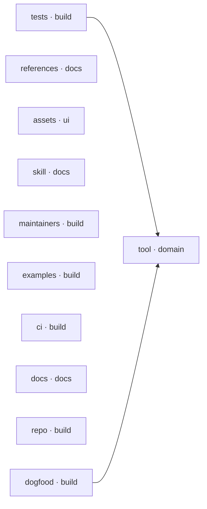

# app-blueprint: structure

<!-- Generated by blueprint.py render from .blueprint/blueprint.json. Do not edit. -->

The repository's own plan: who builds which file of app-blueprint 2.0, taken from section 11 of the contract.

**141 planned files, 7 patterns.** Status: ○ planned 60, ◑ on disk 81. Last sync: 2026-11-20T03:01:24Z at `cb194a8`.

## Build approach

- **layout:** app-blueprint/ is the skill (SKILL.md, scripts, tests, references, assets); maintainers/ holds the maintainers' tools and the design contract; examples/ is generated; .blueprint/ is this plan.
- **notes:** A plan of files and owners only. Owner rules give every file, including files later waves will create, exactly one owner; maintainers/check_owned.py reads them to check a branch. Update the rules only when section 11 of maintainers/design/v2-contract.md changes.

## Tree

`★` shared contract · `○` planned · `◔` claimed · `◑` on disk · `●` built · `✔` verified · `▲` blocked

```text
.
├── .blueprint/  # This repository's own plan and views [dogfood]
│   └── *  ⟨pattern dogfood-views: The plan, its state and the generated views of this repository; 6 on disk⟩ (orchestrator, W0)
├── .github/  # GitHub workflows and templates [ci]
│   ├── ISSUE_TEMPLATE/
│   │   └── *  ⟨pattern issue-templates: GitHub issue forms; 5 on disk⟩ (maintainers, W0)
│   ├── workflows/
│   │   ├── mutation.yml  ○ Scheduled mutation job (W4-M, W4)
│   │   └── tests.yml [modify]  ◑ CI test workflow (maintainers, W0)
│   └── pull_request_template.md [modify]  ◑ Pull request template (maintainers, W0)
├── app-blueprint/  # SKILL.md and the agent files of the skill [skill]
│   ├── agents/
│   │   ├── blueprint-evaluator.md  ○ Evaluator agent (W3-A, W3)
│   │   ├── blueprint-surveyor.md  ○ Surveyor agent (W3-A, W3)
│   │   └── openai.yaml [modify]  ◑ Agent descriptor for OpenAI-style hosts (maintainers, W0)
│   ├── assets/  # The map template and the browser scripts of its tabs [assets]
│   │   ├── map.template.html  ◑ Template of map.html with the tab plug-in point (W0-A2, W0)
│   │   ├── mindmap.js [modify]  ◑ Mind map of the map, with the by-feature mode (W1-F, W1)
│   │   ├── tab-features.js  ○ Features tab of the map (W1-F, W1)
│   │   ├── tab-roadmap.js  ○ Roadmap tab of the map (W1-R, W1)
│   │   ├── tab-studies.js  ○ Studies tab of the map (W2-E, W2)
│   │   └── tab-unknowns.js  ○ Unknowns tab of the map (W1-U, W1)
│   ├── references/  # Reference documents and example plans the skill points to [references]
│   │   ├── stacks/
│   │   │   └── *.md  ⟨pattern stack-presets: Stack presets the tool offers at init; 4 on disk⟩ (maintainers, W0)
│   │   ├── agent-rules.md [modify]  ◑ Rules for builder agents (W3-R1, W3)
│   │   ├── example-blueprint-v2.json  ◑ A complete version 2 plan used by the tests and the docs (W0-B, W0)
│   │   ├── example-blueprint.json [modify]  ◑ The version 1 example plan (maintainers, W0)
│   │   ├── hooks.md [modify]  ◑ Hook installation and protected paths (W3-R2, W3)
│   │   ├── integrations.md [modify]  ◑ Integrations with other tools (W3-R2, W3)
│   │   ├── readiness-review.md [modify]  ◑ Readiness review checklist (W3-R1, W3)
│   │   └── schema.md [modify]  ◑ Field reference of blueprint.json (W3-R2, W3)
│   ├── scripts/  # The tool: launcher and the bp package [tool]
│   │   ├── bp/
│   │   │   ├── commands/
│   │   │   │   ├── __init__.py  ◑ Package marker for the command modules (W0-A2, W0)
│   │   │   │   ├── data.py  ◑ The db-check command (W0-A2, W0)
│   │   │   │   ├── evidence.py  ○ The evidence command (W2-E, W2)
│   │   │   │   ├── learn.py  ◑ feedback, report and doctor commands (W0-A2, W0)
│   │   │   │   ├── migrate.py  ◑ The migrate command (W0-B, W0)
│   │   │   │   ├── plan.py  ◑ init, validate, render, contracts and export commands (W0-A2, W0)
│   │   │   │   ├── progress.py  ◑ sync, status, owner, claim, mark, verify, guard and hook commands (W0-A2, W0)
│   │   │   │   ├── records.py  ○ The accept command (W3-V, W3)
│   │   │   │   ├── roadmap.py  ○ The task command (W1-R, W1)
│   │   │   │   └── study.py  ○ The study command (W2-E, W2)
│   │   │   ├── study/
│   │   │   │   ├── __init__.py  ○ Package marker for the study engine (W2-E, W2)
│   │   │   │   ├── aabproto.py  ○ Reader for protobuf manifests of app bundles (W2-M, W2)
│   │   │   │   ├── adopt.py  ○ study adopt: evidence into plan entries (W2-SY, W2)
│   │   │   │   ├── asar.py  ○ Reader for Electron asar archives (W2-D, W2)
│   │   │   │   ├── axml.py  ○ Reader for binary Android manifests (W2-M, W2)
│   │   │   │   ├── capture.py  ○ Tier B: capture (W2-T, W2)
│   │   │   │   ├── compare.py  ○ Compare lane (W2-DA, W2)
│   │   │   │   ├── datafiles.py  ○ Data lane: data files (W2-DA, W2)
│   │   │   │   ├── desktop.py  ○ Desktop lane: Electron (W2-D, W2)
│   │   │   │   ├── dex.py  ○ Reader for dex files (W2-M, W2)
│   │   │   │   ├── engine.py  ○ Lane interface and the study run (W2-E, W2)
│   │   │   │   ├── importers.py  ○ Tier C: importers for foreign tools (W2-T, W2)
│   │   │   │   ├── jsscan.py  ○ JavaScript scanner shared by the web, desktop and mobile lanes (W2-W, W2)
│   │   │   │   ├── keys.py  ○ Record keys shared by the lanes (W2-E, W2)
│   │   │   │   ├── mobile.py  ○ Mobile lane: APK, AAB, XAPK, IPA (W2-M, W2)
│   │   │   │   ├── safety.py  ○ Read limits, hostile-input rules and secret scanning (W2-E, W2)
│   │   │   │   ├── source.py  ○ Source lane: repositories and the import graph (W2-S, W2)
│   │   │   │   ├── synth.py  ○ Synthesis of behaviours from evidence (W2-SY, W2)
│   │   │   │   ├── trace.py  ○ study trace: roles and depth (W2-S, W2)
│   │   │   │   └── web.py  ○ Web lane: HAR, source maps and bundles (W2-W, W2)
│   │   │   ├── views/
│   │   │   │   ├── __init__.py  ◑ Package marker for the view modules (W0-A2, W0)
│   │   │   │   ├── context.py  ◑ The context every view and status hook reads (W0-A2, W0)
│   │   │   │   ├── features_md.py  ○ FEATURES.md (W1-F, W1)
│   │   │   │   ├── render.py  ◑ Writes every view and the map (W0-A2, W0)
│   │   │   │   ├── roadmap_md.py  ○ ROADMAP.md (W1-R, W1)
│   │   │   │   ├── roster.py  ◑ ROSTER.md (W0-A2, W0)
│   │   │   │   └── structure.py  ◑ STRUCTURE.md (W0-A2, W0)
│   │   │   ├── __init__.py  ◑ Package marker for bp (W0-A2, W0)
│   │   │   ├── api.py  ◑ Frozen 1.x public names re-exported to the launcher (W0-A2, W0)
│   │   │   ├── cli.py  ◑ Argument parser, start-up completeness check and command dispatch (W0-A2, W0)
│   │   │   ├── core.py ★  ◑ Paths, JSON and git helpers, BlueprintError and the envelope, proofs (W0-A2, W0)
│   │   │   ├── data.py  ◑ Stores and resources: SQL, Prisma and code scanning for the data checks (W0-A2, W0)
│   │   │   ├── evidence.py  ○ Evidence store and records (W2-E, W2)
│   │   │   ├── export.py  ◑ Export formats: codeowners, csv, json, AgenticTeam commands (W0-A2, W0)
│   │   │   ├── features.py  ○ Features, criteria, file links and derived status (W1-F, W1)
│   │   │   ├── globs.py  ◑ Glob matching for owner rules, patterns and ignores (W0-A2, W0)
│   │   │   ├── install.py  ◑ Copy of the tool into .blueprint/bin and the package start-up check (W0-A2, W0)
│   │   │   ├── learn.py  ◑ Learning-loop store, redaction and incident records (W0-A2, W0)
│   │   │   ├── migrate.py  ◑ In-memory upgrade of plans and state from version 1 to 2 (W0-A2, W0)
│   │   │   ├── plan.py  ◑ Plan loading, shape checks and the skeleton (W0-A2, W0)
│   │   │   ├── records.py  ○ Verification records, criterion checks and acceptance (W3-V, W3)
│   │   │   ├── registry.py ★  ◑ Module registry, hook collection and validation code ownership (W0-A2, W0)
│   │   │   ├── roadmap.py  ○ Milestones and tasks: rules, ladder, owner actions (W1-R, W1)
│   │   │   ├── rules.py  ◑ Owner rules, roster and team validation (W0-A2, W0)
│   │   │   ├── signals.py  ○ Automatic loop signals (W3-L, W3)
│   │   │   ├── status.py  ◑ Status computation, claim rules and the guard decision (W0-A2, W0)
│   │   │   ├── unknowns.py  ○ Unknowns, experiments, blocking and claim refusal (W1-U, W1)
│   │   │   ├── validate.py  ◑ Validation findings, codes and the schema checks (W0-A2, W0)
│   │   │   ├── verify.py  ◑ Verify commands and the hash of a verified file (W0-A2, W0)
│   │   │   └── version.py [modify]  ◑ TOOL_VERSION and schema version constants (orchestrator, W0)
│   │   └── blueprint.py [modify]  ◑ Launcher: carries the TOOL_VERSION line (orchestrator, W0)
│   ├── tests/  # Tests of the tool, fixtures and golden data [tests]
│   │   ├── data/
│   │   │   ├── android/
│   │   │   │   └── **  ⟨pattern android-goldens: Goldens built with aapt2; 3 on disk⟩ (W2-FX1, W2)
│   │   │   ├── v1/
│   │   │   │   └── **  ⟨pattern v1-goldens: Frozen 1.3.0 inputs and golden views; 4 on disk⟩ (W0-A2, W0)
│   │   │   └── README.md [modify]  ◑ Where the golden files came from and how to rebuild them (W2-FX1, W2)
│   │   ├── fixtures_archives.py [modify]  ◑ Builders for APK, AAB, XAPK, IPA, asar and hostile archives (W2-FX1, W2)
│   │   ├── fixtures_text.py [modify]  ◑ Builders for HAR, source map, bundle, SQLite, OpenAPI, GraphQL, proto, repo, rea, JADX, apktool and capture fixtures (W2-FX2, W2)
│   │   ├── support.py  ◑ Shared test helpers for loading the tool (W0-A2, W0)
│   │   ├── test_agents.py  ○ Tests of the agent files against the real CLI (W3-A, W3)
│   │   ├── test_blueprint.py  ◑ The 1.3.0 behaviour tests of the tool (W0-A2, W0)
│   │   ├── test_contracts_module.py  ◑ Tests of module README contracts (W0-A2, W0)
│   │   ├── test_data_and_learning.py  ◑ The 1.3.0 tests of the data checks and the learning loop (W0-A2, W0)
│   │   ├── test_docs.py  ○ Checks that the docs match the real CLI (W3-R2, W3)
│   │   ├── test_e2e.py  ○ End-to-end tests (W4-E2E, W4)
│   │   ├── test_evidence.py  ○ Tests of the evidence store (W2-E, W2)
│   │   ├── test_features.py  ○ Tests of features and FEATURES.md (W1-F, W1)
│   │   ├── test_fixtures_archives.py [modify]  ◑ Structural self-checks of the archive builders (W2-FX1, W2)
│   │   ├── test_fixtures_text.py [modify]  ◑ Self-checks of the text builders (W2-FX2, W2)
│   │   ├── test_ignore_anchor.py  ◑ Tests of ignore rule anchoring (W0-A2, W0)
│   │   ├── test_migrate.py  ◑ Tests of the migrate command (W0-B, W0)
│   │   ├── test_owner_anchor.py  ◑ Tests of owner rule anchoring (W0-A2, W0)
│   │   ├── test_package.py  ◑ Package layout, 1.x names, version lines and interrupted-copy tests (W0-A2, W0)
│   │   ├── test_plan_fuzz.py  ◑ Fuzz tests of version 1 plans (W0-A2, W0)
│   │   ├── test_plan_fuzz_v2.py  ◑ Fuzz tests of version 2 plans, run with each module loaded (W0-A2, W0)
│   │   ├── test_plan_shapes.py  ◑ Tests of plan shape errors (W0-A2, W0)
│   │   ├── test_presets.py  ◑ Tests of the stack presets (W0-A2, W0)
│   │   ├── test_records.py  ○ Tests of verification records (W3-V, W3)
│   │   ├── test_registry.py  ○ Tests of the registry across all modules (W4-E2E, W4)
│   │   ├── test_registry_hooks.py  ◑ Tests of the registry and every hook with a stub module (W0-A2, W0)
│   │   ├── test_roadmap.py  ○ Tests of milestones, tasks and ROADMAP.md (W1-R, W1)
│   │   ├── test_signals.py  ○ Tests of signals (W3-L, W3)
│   │   ├── test_state_integrity.py  ○ Tests of state locking, atomic writes and a broken state.json (W0-A2, W0)
│   │   ├── test_study_core.py  ○ Tests of the study engine and its safety rules (W2-E, W2)
│   │   ├── test_study_data.py  ○ Tests of the data and compare lanes (W2-DA, W2)
│   │   ├── test_study_desktop.py  ○ Tests of the desktop lane (W2-D, W2)
│   │   ├── test_study_import.py  ○ Tests of capture and importers (W2-T, W2)
│   │   ├── test_study_mobile.py  ○ Tests of the mobile lane and its parsers (W2-M, W2)
│   │   ├── test_study_source.py  ○ Tests of the source lane and trace (W2-S, W2)
│   │   ├── test_study_web.py  ○ Tests of the web lane (W2-W, W2)
│   │   ├── test_synth.py  ○ Tests of synth, check and adopt (W2-SY, W2)
│   │   ├── test_unknowns.py  ○ Tests of unknowns (W1-U, W1)
│   │   └── test_validate.py  ◑ Tests of validation codes and findings (W0-A2, W0)
│   └── SKILL.md [modify]  ◑ The skill: when and how an agent uses the tool (W3-R1, W3)
├── examples/  # The generated example project [examples]
│   ├── */
│   │   └── .blueprint/
│   │       └── **  ⟨pattern example-plan: The example's own plan, state, views and tool copy; 0 on disk⟩ (orchestrator, W0)
│   └── **  ⟨pattern example-project: The generated example project, rebuilt by maintainers/make_example.py; 50 on disk⟩ (orchestrator, W0)
├── learning/
│   └── LESSONS.md [modify]  ◑ Lessons the learning loop has adopted (maintainers, W0)
├── maintainers/  # Maintainers' tools, specification, design contract and learning-loop agents [maintainers]
│   ├── agents/
│   │   ├── blueprint-fixer.md [modify]  ◑ Fixer agent of the learning loop (W3-L, W3)
│   │   ├── blueprint-harvester.md [modify]  ◑ Harvester agent of the learning loop (W3-L, W3)
│   │   ├── blueprint-reviewer.md [modify]  ◑ Reviewer agent of the learning loop (W3-L, W3)
│   │   └── preset-scout.md [modify]  ◑ Preset scout agent (maintainers, W0)
│   ├── design/
│   │   └── v2-contract.md [modify] ★  ◑ The contract of version 2.0 (orchestrator, W0)
│   ├── tests/
│   │   ├── test_check_owned.py  ◑ Tests of the ownership check on throwaway git repositories (W0-C, W0)
│   │   └── test_learn.py [modify]  ◑ Tests of the maintainers' learning-loop command (W3-L, W3)
│   ├── check_owned.py  ◑ Pull-request ownership check: changed paths against the roster (W0-C, W0)
│   ├── learn.py [modify]  ◑ Maintainers' learning-loop command (W3-L, W3)
│   ├── make_example.py [modify]  ◑ Generator of the example project (W4-X, W4)
│   ├── mutate.py  ○ Mutation runner (W4-M, W4)
│   ├── mutations.json  ○ The mutations (W4-M, W4)
│   ├── README.md [modify]  ◑ Guide to the maintainers' folder (maintainers, W0)
│   └── SPEC.md [modify]  ◑ Specification of the learning loop (W3-L, W3)
├── .gitattributes [modify]  ◑ Line ending and binary file rules (maintainers, W0)
├── .gitignore [modify]  ◑ Whitelist of the published paths (orchestrator, W0)
├── CHANGELOG.md [modify]  ◑ Changelog (orchestrator, W0)
├── CONTRIBUTING.md [modify]  ◑ How to contribute (maintainers, W0)
├── install.py [modify]  ◑ Installer of the skill and its agents (W3-A, W3)
├── LICENSE [modify]  ◑ License (maintainers, W0)
└── README.md [modify]  ◑ Project README (W3-R2, W3)
```

## Modules



| Module | Path | Layer | Purpose | Depends on | Verify |
|---|---|---|---|---|---|
| tool | `app-blueprint/scripts` | domain | The tool: launcher and the bp package |  | `python app-blueprint/scripts/blueprint.py --version` |
| tests | `app-blueprint/tests` | build | Tests of the tool, fixtures and golden data | tool | `python -m unittest discover -s app-blueprint/tests` |
| references | `app-blueprint/references` | docs | Reference documents and example plans the skill points to |  | `python app-blueprint/scripts/blueprint.py validate --root examples/snag-desk` |
| assets | `app-blueprint/assets` | ui | The map template and the browser scripts of its tabs |  | `python app-blueprint/scripts/blueprint.py --version` |
| skill | `app-blueprint` | docs | SKILL.md and the agent files of the skill |  | `python app-blueprint/scripts/blueprint.py --version` |
| maintainers | `maintainers` | build | Maintainers' tools, specification, design contract and learning-loop agents |  | `python -m unittest discover -s maintainers/tests` |
| examples | `examples` | build | The generated example project |  | `python app-blueprint/scripts/blueprint.py validate --root examples/snag-desk` |
| ci | `.github` | build | GitHub workflows and templates |  | `python -c "pass"` |
| docs | `` | docs | Repository-level documents: README, changelog, contributing, license, lessons |  | `python -c "pass"` |
| repo | `` | build | Repository-level configuration and the installer |  | `python -c "pass"` |
| dogfood | `.blueprint` | build | This repository's own plan and views | tool | `python app-blueprint/scripts/blueprint.py validate` |

## Phases

| Phase | Name | Goal | Exit | Files | Verified |
|---|---|---|---|---|---|
| W0 | Foundations | The package split, the 2.0 foundations, migrate, and this plan with its ownership check. | validate passes on this plan; check_owned.py passes on a branch of its own files | 61 | 0 |
| W1 | Roadmap, features, unknowns | Milestones and tasks, features and criteria, unknowns and blocking. | the Wave 1 tests and test_plan_fuzz_v2 pass with each module loaded | 13 | 0 |
| W2 | Evidence and study | Fixtures, the evidence store, the study engine and its lanes, synthesis. | the Wave 2 tests pass; hostile archives and the time bound hold | 38 | 0 |
| W3 | Verification, agents, docs | Verification records, the surveyor and evaluator agents, builder rules, references and the docs check, learning-loop upgrades. | test_docs and test_agents pass; every command in the docs parses with the real CLI | 23 | 0 |
| W4 | End to end and release | End-to-end and registry tests, mutation testing, example changes, version 2.0.0. | the full suite and the mutation job pass; TOOL_VERSION is 2.0.0 | 6 | 0 |

## Shared contracts

These files are depended on by several owners. Change them only through their owner.

| File | Owner | Produces | Purpose |
|---|---|---|---|
| `app-blueprint/scripts/bp/core.py` | W0-A2 |  | Paths, JSON and git helpers, BlueprintError and the envelope, proofs |
| `app-blueprint/scripts/bp/registry.py` | W0-A2 |  | Module registry, hook collection and validation code ownership |
| `maintainers/design/v2-contract.md` | orchestrator |  | The contract of version 2.0 |

## Repeated-file patterns

| Pattern | Glob | One instance contains | Owner | Phase | On disk |
|---|---|---|---|---|---|
| dogfood-views | `.blueprint/*` | One file init, sync or render writes in .blueprint/ (README.md, blueprint.json, state.json, log.jsonl, STRUCTURE.md, ROSTER.md, map.html, and later ROADMAP.md and FEATURES.md). The tool copy in .blueprint/bin is not committed. | orchestrator | W0 | 6 |
| example-project | `examples/**` | One file of the example, including its own .blueprint folder and tool copy; never edited by hand. | orchestrator | W0 | 50 |
| example-plan | `examples/*/.blueprint/**` | One file under an example's .blueprint folder, written by the tool when make_example.py runs. | orchestrator | W0 | 0 |
| v1-goldens | `app-blueprint/tests/data/v1/**` | One frozen input, golden or generator script of the version 1 behaviour tests. | W0-A2 | W0 | 4 |
| android-goldens | `app-blueprint/tests/data/android/**` | One manifest source or aapt2 output (text, binary AXML or proto). | W2-FX1 | W2 | 3 |
| issue-templates | `.github/ISSUE_TEMPLATE/*` | One issue form or the issue chooser config. | maintainers | W0 | 5 |
| stack-presets | `app-blueprint/references/stacks/*.md` | One stack preset document with its parts, versions, docs URLs and folder layout. | maintainers | W0 | 4 |

## Files

| File | Action | Module | Phase | Owner | Status | Purpose | Consumes | Produces | Verify |
|---|---|---|---|---|---|---|---|---|---|
| `app-blueprint/scripts/bp/views/__init__.py` | create | tool | W0 | W0-A2 | ◑ on disk | Package marker for the view modules |  |  | `python app-blueprint/scripts/blueprint.py --version` |
| `app-blueprint/scripts/bp/__init__.py` | create | tool | W0 | W0-A2 | ◑ on disk | Package marker for bp |  |  | `python app-blueprint/scripts/blueprint.py --version` |
| `app-blueprint/scripts/bp/globs.py` | create | tool | W0 | W0-A2 | ◑ on disk | Glob matching for owner rules, patterns and ignores |  |  | `python app-blueprint/scripts/blueprint.py --version` |
| `app-blueprint/scripts/bp/learn.py` | create | tool | W0 | W0-A2 | ◑ on disk | Learning-loop store, redaction and incident records |  |  | `python app-blueprint/scripts/blueprint.py --version` |
| `app-blueprint/scripts/bp/export.py` | create | tool | W0 | W0-A2 | ◑ on disk | Export formats: codeowners, csv, json, AgenticTeam commands |  |  | `python app-blueprint/scripts/blueprint.py --version` |
| `app-blueprint/scripts/bp/install.py` | create | tool | W0 | W0-A2 | ◑ on disk | Copy of the tool into .blueprint/bin and the package start-up check |  |  | `python app-blueprint/scripts/blueprint.py --version` |
| `app-blueprint/scripts/bp/api.py` | create | tool | W0 | W0-A2 | ◑ on disk | Frozen 1.x public names re-exported to the launcher |  |  | `python app-blueprint/scripts/blueprint.py --version` |
| `app-blueprint/scripts/bp/commands/__init__.py` | create | tool | W0 | W0-A2 | ◑ on disk | Package marker for the command modules |  |  | `python app-blueprint/scripts/blueprint.py --version` |
| `app-blueprint/scripts/bp/commands/data.py` | create | tool | W0 | W0-A2 | ◑ on disk | The db-check command |  |  | `python app-blueprint/scripts/blueprint.py --version` |
| `app-blueprint/tests/support.py` | create | tests | W0 | W0-A2 | ◑ on disk | Shared test helpers for loading the tool |  |  | `python -m unittest discover -s app-blueprint/tests` |
| `app-blueprint/tests/test_package.py` | create | tests | W0 | W0-A2 | ◑ on disk | Package layout, 1.x names, version lines and interrupted-copy tests |  |  | `python -m unittest discover -s app-blueprint/tests` |
| `app-blueprint/tests/test_blueprint.py` | create | tests | W0 | W0-A2 | ◑ on disk | The 1.3.0 behaviour tests of the tool |  |  | `python -m unittest discover -s app-blueprint/tests` |
| `app-blueprint/tests/test_data_and_learning.py` | create | tests | W0 | W0-A2 | ◑ on disk | The 1.3.0 tests of the data checks and the learning loop |  |  | `python -m unittest discover -s app-blueprint/tests` |
| `app-blueprint/tests/test_presets.py` | create | tests | W0 | W0-A2 | ◑ on disk | Tests of the stack presets |  |  | `python -m unittest discover -s app-blueprint/tests` |
| `app-blueprint/tests/test_contracts_module.py` | create | tests | W0 | W0-A2 | ◑ on disk | Tests of module README contracts |  |  | `python -m unittest discover -s app-blueprint/tests` |
| `app-blueprint/tests/test_ignore_anchor.py` | create | tests | W0 | W0-A2 | ◑ on disk | Tests of ignore rule anchoring |  |  | `python -m unittest discover -s app-blueprint/tests` |
| `app-blueprint/tests/test_owner_anchor.py` | create | tests | W0 | W0-A2 | ◑ on disk | Tests of owner rule anchoring |  |  | `python -m unittest discover -s app-blueprint/tests` |
| `app-blueprint/tests/test_plan_shapes.py` | create | tests | W0 | W0-A2 | ◑ on disk | Tests of plan shape errors |  |  | `python -m unittest discover -s app-blueprint/tests` |
| `app-blueprint/tests/test_plan_fuzz.py` | create | tests | W0 | W0-A2 | ◑ on disk | Fuzz tests of version 1 plans |  |  | `python -m unittest discover -s app-blueprint/tests` |
| `app-blueprint/scripts/bp/data.py` | create | tool | W0 | W0-A2 | ◑ on disk | Stores and resources: SQL, Prisma and code scanning for the data checks |  |  | `python app-blueprint/scripts/blueprint.py --version` |
| `app-blueprint/scripts/bp/core.py` | create | tool | W0 | W0-A2 | ◑ on disk | Paths, JSON and git helpers, BlueprintError and the envelope, proofs |  |  | `python app-blueprint/scripts/blueprint.py --version` |
| `app-blueprint/scripts/bp/plan.py` | create | tool | W0 | W0-A2 | ◑ on disk | Plan loading, shape checks and the skeleton |  |  | `python app-blueprint/scripts/blueprint.py --version` |
| `app-blueprint/scripts/bp/rules.py` | create | tool | W0 | W0-A2 | ◑ on disk | Owner rules, roster and team validation |  |  | `python app-blueprint/scripts/blueprint.py --version` |
| `app-blueprint/scripts/bp/status.py` | create | tool | W0 | W0-A2 | ◑ on disk | Status computation, claim rules and the guard decision |  |  | `python app-blueprint/scripts/blueprint.py --version` |
| `app-blueprint/scripts/bp/verify.py` | create | tool | W0 | W0-A2 | ◑ on disk | Verify commands and the hash of a verified file |  |  | `python app-blueprint/scripts/blueprint.py --version` |
| `app-blueprint/scripts/bp/validate.py` | create | tool | W0 | W0-A2 | ◑ on disk | Validation findings, codes and the schema checks |  |  | `python app-blueprint/scripts/blueprint.py --version` |
| `app-blueprint/scripts/bp/cli.py` | create | tool | W0 | W0-A2 | ◑ on disk | Argument parser, start-up completeness check and command dispatch |  |  | `python app-blueprint/scripts/blueprint.py --version` |
| `app-blueprint/scripts/bp/views/structure.py` | create | tool | W0 | W0-A2 | ◑ on disk | STRUCTURE.md |  |  | `python app-blueprint/scripts/blueprint.py --version` |
| `app-blueprint/scripts/bp/views/render.py` | create | tool | W0 | W0-A2 | ◑ on disk | Writes every view and the map |  |  | `python app-blueprint/scripts/blueprint.py --version` |
| `app-blueprint/scripts/bp/views/roster.py` | create | tool | W0 | W0-A2 | ◑ on disk | ROSTER.md |  |  | `python app-blueprint/scripts/blueprint.py --version` |
| `app-blueprint/scripts/bp/views/context.py` | create | tool | W0 | W0-A2 | ◑ on disk | The context every view and status hook reads |  |  | `python app-blueprint/scripts/blueprint.py --version` |
| `app-blueprint/scripts/bp/commands/plan.py` | create | tool | W0 | W0-A2 | ◑ on disk | init, validate, render, contracts and export commands |  |  | `python app-blueprint/scripts/blueprint.py --version` |
| `app-blueprint/scripts/bp/commands/progress.py` | create | tool | W0 | W0-A2 | ◑ on disk | sync, status, owner, claim, mark, verify, guard and hook commands |  |  | `python app-blueprint/scripts/blueprint.py --version` |
| `app-blueprint/scripts/bp/commands/learn.py` | create | tool | W0 | W0-A2 | ◑ on disk | feedback, report and doctor commands |  |  | `python app-blueprint/scripts/blueprint.py --version` |
| `app-blueprint/scripts/bp/registry.py` | create | tool | W0 | W0-A2 | ◑ on disk | Module registry, hook collection and validation code ownership |  |  | `python app-blueprint/scripts/blueprint.py --version` |
| `app-blueprint/scripts/bp/migrate.py` | create | tool | W0 | W0-A2 | ◑ on disk | In-memory upgrade of plans and state from version 1 to 2 |  |  | `python app-blueprint/scripts/blueprint.py --version` |
| `app-blueprint/assets/map.template.html` | create | assets | W0 | W0-A2 | ◑ on disk | Template of map.html with the tab plug-in point |  |  | `python app-blueprint/scripts/blueprint.py --version` |
| `app-blueprint/tests/test_validate.py` | create | tests | W0 | W0-A2 | ◑ on disk | Tests of validation codes and findings |  |  | `python -m unittest discover -s app-blueprint/tests` |
| `app-blueprint/tests/test_registry_hooks.py` | create | tests | W0 | W0-A2 | ◑ on disk | Tests of the registry and every hook with a stub module |  |  | `python -m unittest discover -s app-blueprint/tests` |
| `app-blueprint/tests/test_plan_fuzz_v2.py` | create | tests | W0 | W0-A2 | ◑ on disk | Fuzz tests of version 2 plans, run with each module loaded |  |  | `python -m unittest discover -s app-blueprint/tests` |
| `app-blueprint/scripts/bp/commands/migrate.py` | create | tool | W0 | W0-B | ◑ on disk | The migrate command |  |  | `python app-blueprint/scripts/blueprint.py --version` |
| `app-blueprint/references/example-blueprint-v2.json` | create | references | W0 | W0-B | ◑ on disk | A complete version 2 plan used by the tests and the docs |  |  | `python app-blueprint/scripts/blueprint.py validate --root examples/snag-desk` |
| `app-blueprint/tests/test_migrate.py` | create | tests | W0 | W0-B | ◑ on disk | Tests of the migrate command |  |  | `python -m unittest discover -s app-blueprint/tests` |
| `maintainers/check_owned.py` | create | maintainers | W0 | W0-C | ◑ on disk | Pull-request ownership check: changed paths against the roster |  |  | `python -m unittest discover -s maintainers/tests` |
| `maintainers/tests/test_check_owned.py` | create | maintainers | W0 | W0-C | ◑ on disk | Tests of the ownership check on throwaway git repositories |  |  | `python -m unittest discover -s maintainers/tests` |
| `app-blueprint/scripts/bp/roadmap.py` | create | tool | W1 | W1-R | ○ planned | Milestones and tasks: rules, ladder, owner actions |  |  | `python app-blueprint/scripts/blueprint.py --version` |
| `app-blueprint/scripts/bp/commands/roadmap.py` | create | tool | W1 | W1-R | ○ planned | The task command |  |  | `python app-blueprint/scripts/blueprint.py --version` |
| `app-blueprint/scripts/bp/views/roadmap_md.py` | create | tool | W1 | W1-R | ○ planned | ROADMAP.md |  |  | `python app-blueprint/scripts/blueprint.py --version` |
| `app-blueprint/assets/tab-roadmap.js` | create | assets | W1 | W1-R | ○ planned | Roadmap tab of the map |  |  | `python app-blueprint/scripts/blueprint.py --version` |
| `app-blueprint/tests/test_roadmap.py` | create | tests | W1 | W1-R | ○ planned | Tests of milestones, tasks and ROADMAP.md |  |  | `python -m unittest discover -s app-blueprint/tests` |
| `app-blueprint/scripts/bp/features.py` | create | tool | W1 | W1-F | ○ planned | Features, criteria, file links and derived status |  |  | `python app-blueprint/scripts/blueprint.py --version` |
| `app-blueprint/scripts/bp/views/features_md.py` | create | tool | W1 | W1-F | ○ planned | FEATURES.md |  |  | `python app-blueprint/scripts/blueprint.py --version` |
| `app-blueprint/assets/tab-features.js` | create | assets | W1 | W1-F | ○ planned | Features tab of the map |  |  | `python app-blueprint/scripts/blueprint.py --version` |
| `app-blueprint/assets/mindmap.js` | modify | assets | W1 | W1-F | ◑ on disk | Mind map of the map, with the by-feature mode |  |  | `python app-blueprint/scripts/blueprint.py --version` |
| `app-blueprint/tests/test_features.py` | create | tests | W1 | W1-F | ○ planned | Tests of features and FEATURES.md |  |  | `python -m unittest discover -s app-blueprint/tests` |
| `app-blueprint/scripts/bp/unknowns.py` | create | tool | W1 | W1-U | ○ planned | Unknowns, experiments, blocking and claim refusal |  |  | `python app-blueprint/scripts/blueprint.py --version` |
| `app-blueprint/assets/tab-unknowns.js` | create | assets | W1 | W1-U | ○ planned | Unknowns tab of the map |  |  | `python app-blueprint/scripts/blueprint.py --version` |
| `app-blueprint/tests/test_unknowns.py` | create | tests | W1 | W1-U | ○ planned | Tests of unknowns |  |  | `python -m unittest discover -s app-blueprint/tests` |
| `app-blueprint/tests/fixtures_archives.py` | modify | tests | W2 | W2-FX1 | ◑ on disk | Builders for APK, AAB, XAPK, IPA, asar and hostile archives |  |  | `python -m unittest discover -s app-blueprint/tests` |
| `app-blueprint/tests/test_fixtures_archives.py` | modify | tests | W2 | W2-FX1 | ◑ on disk | Structural self-checks of the archive builders |  |  | `python -m unittest discover -s app-blueprint/tests` |
| `app-blueprint/tests/data/README.md` | modify | tests | W2 | W2-FX1 | ◑ on disk | Where the golden files came from and how to rebuild them |  |  | `python -m unittest discover -s app-blueprint/tests` |
| `app-blueprint/tests/fixtures_text.py` | modify | tests | W2 | W2-FX2 | ◑ on disk | Builders for HAR, source map, bundle, SQLite, OpenAPI, GraphQL, proto, repo, rea, JADX, apktool and capture fixtures |  |  | `python -m unittest discover -s app-blueprint/tests` |
| `app-blueprint/tests/test_fixtures_text.py` | modify | tests | W2 | W2-FX2 | ◑ on disk | Self-checks of the text builders |  |  | `python -m unittest discover -s app-blueprint/tests` |
| `app-blueprint/scripts/bp/evidence.py` | create | tool | W2 | W2-E | ○ planned | Evidence store and records |  |  | `python app-blueprint/scripts/blueprint.py --version` |
| `app-blueprint/scripts/bp/study/__init__.py` | create | tool | W2 | W2-E | ○ planned | Package marker for the study engine |  |  | `python app-blueprint/scripts/blueprint.py --version` |
| `app-blueprint/scripts/bp/study/engine.py` | create | tool | W2 | W2-E | ○ planned | Lane interface and the study run |  |  | `python app-blueprint/scripts/blueprint.py --version` |
| `app-blueprint/scripts/bp/study/safety.py` | create | tool | W2 | W2-E | ○ planned | Read limits, hostile-input rules and secret scanning |  |  | `python app-blueprint/scripts/blueprint.py --version` |
| `app-blueprint/scripts/bp/study/keys.py` | create | tool | W2 | W2-E | ○ planned | Record keys shared by the lanes |  |  | `python app-blueprint/scripts/blueprint.py --version` |
| `app-blueprint/scripts/bp/commands/evidence.py` | create | tool | W2 | W2-E | ○ planned | The evidence command |  |  | `python app-blueprint/scripts/blueprint.py --version` |
| `app-blueprint/scripts/bp/commands/study.py` | create | tool | W2 | W2-E | ○ planned | The study command |  |  | `python app-blueprint/scripts/blueprint.py --version` |
| `app-blueprint/assets/tab-studies.js` | create | assets | W2 | W2-E | ○ planned | Studies tab of the map |  |  | `python app-blueprint/scripts/blueprint.py --version` |
| `app-blueprint/tests/test_evidence.py` | create | tests | W2 | W2-E | ○ planned | Tests of the evidence store |  |  | `python -m unittest discover -s app-blueprint/tests` |
| `app-blueprint/tests/test_study_core.py` | create | tests | W2 | W2-E | ○ planned | Tests of the study engine and its safety rules |  |  | `python -m unittest discover -s app-blueprint/tests` |
| `app-blueprint/scripts/bp/study/source.py` | create | tool | W2 | W2-S | ○ planned | Source lane: repositories and the import graph |  |  | `python app-blueprint/scripts/blueprint.py --version` |
| `app-blueprint/scripts/bp/study/trace.py` | create | tool | W2 | W2-S | ○ planned | study trace: roles and depth |  |  | `python app-blueprint/scripts/blueprint.py --version` |
| `app-blueprint/tests/test_study_source.py` | create | tests | W2 | W2-S | ○ planned | Tests of the source lane and trace |  |  | `python -m unittest discover -s app-blueprint/tests` |
| `app-blueprint/scripts/bp/study/web.py` | create | tool | W2 | W2-W | ○ planned | Web lane: HAR, source maps and bundles |  |  | `python app-blueprint/scripts/blueprint.py --version` |
| `app-blueprint/scripts/bp/study/jsscan.py` | create | tool | W2 | W2-W | ○ planned | JavaScript scanner shared by the web, desktop and mobile lanes |  |  | `python app-blueprint/scripts/blueprint.py --version` |
| `app-blueprint/tests/test_study_web.py` | create | tests | W2 | W2-W | ○ planned | Tests of the web lane |  |  | `python -m unittest discover -s app-blueprint/tests` |
| `app-blueprint/scripts/bp/study/asar.py` | create | tool | W2 | W2-D | ○ planned | Reader for Electron asar archives |  |  | `python app-blueprint/scripts/blueprint.py --version` |
| `app-blueprint/scripts/bp/study/desktop.py` | create | tool | W2 | W2-D | ○ planned | Desktop lane: Electron |  |  | `python app-blueprint/scripts/blueprint.py --version` |
| `app-blueprint/tests/test_study_desktop.py` | create | tests | W2 | W2-D | ○ planned | Tests of the desktop lane |  |  | `python -m unittest discover -s app-blueprint/tests` |
| `app-blueprint/scripts/bp/study/axml.py` | create | tool | W2 | W2-M | ○ planned | Reader for binary Android manifests |  |  | `python app-blueprint/scripts/blueprint.py --version` |
| `app-blueprint/scripts/bp/study/aabproto.py` | create | tool | W2 | W2-M | ○ planned | Reader for protobuf manifests of app bundles |  |  | `python app-blueprint/scripts/blueprint.py --version` |
| `app-blueprint/scripts/bp/study/dex.py` | create | tool | W2 | W2-M | ○ planned | Reader for dex files |  |  | `python app-blueprint/scripts/blueprint.py --version` |
| `app-blueprint/scripts/bp/study/mobile.py` | create | tool | W2 | W2-M | ○ planned | Mobile lane: APK, AAB, XAPK, IPA |  |  | `python app-blueprint/scripts/blueprint.py --version` |
| `app-blueprint/tests/test_study_mobile.py` | create | tests | W2 | W2-M | ○ planned | Tests of the mobile lane and its parsers |  |  | `python -m unittest discover -s app-blueprint/tests` |
| `app-blueprint/scripts/bp/study/datafiles.py` | create | tool | W2 | W2-DA | ○ planned | Data lane: data files |  |  | `python app-blueprint/scripts/blueprint.py --version` |
| `app-blueprint/scripts/bp/study/compare.py` | create | tool | W2 | W2-DA | ○ planned | Compare lane |  |  | `python app-blueprint/scripts/blueprint.py --version` |
| `app-blueprint/tests/test_study_data.py` | create | tests | W2 | W2-DA | ○ planned | Tests of the data and compare lanes |  |  | `python -m unittest discover -s app-blueprint/tests` |
| `app-blueprint/scripts/bp/study/capture.py` | create | tool | W2 | W2-T | ○ planned | Tier B: capture |  |  | `python app-blueprint/scripts/blueprint.py --version` |
| `app-blueprint/scripts/bp/study/importers.py` | create | tool | W2 | W2-T | ○ planned | Tier C: importers for foreign tools |  |  | `python app-blueprint/scripts/blueprint.py --version` |
| `app-blueprint/tests/test_study_import.py` | create | tests | W2 | W2-T | ○ planned | Tests of capture and importers |  |  | `python -m unittest discover -s app-blueprint/tests` |
| `app-blueprint/scripts/bp/study/synth.py` | create | tool | W2 | W2-SY | ○ planned | Synthesis of behaviours from evidence |  |  | `python app-blueprint/scripts/blueprint.py --version` |
| `app-blueprint/scripts/bp/study/adopt.py` | create | tool | W2 | W2-SY | ○ planned | study adopt: evidence into plan entries |  |  | `python app-blueprint/scripts/blueprint.py --version` |
| `app-blueprint/tests/test_synth.py` | create | tests | W2 | W2-SY | ○ planned | Tests of synth, check and adopt |  |  | `python -m unittest discover -s app-blueprint/tests` |
| `app-blueprint/scripts/bp/records.py` | create | tool | W3 | W3-V | ○ planned | Verification records, criterion checks and acceptance |  |  | `python app-blueprint/scripts/blueprint.py --version` |
| `app-blueprint/scripts/bp/commands/records.py` | create | tool | W3 | W3-V | ○ planned | The accept command |  |  | `python app-blueprint/scripts/blueprint.py --version` |
| `app-blueprint/tests/test_records.py` | create | tests | W3 | W3-V | ○ planned | Tests of verification records |  |  | `python -m unittest discover -s app-blueprint/tests` |
| `app-blueprint/agents/blueprint-surveyor.md` | create | skill | W3 | W3-A | ○ planned | Surveyor agent |  |  | `python app-blueprint/scripts/blueprint.py --version` |
| `app-blueprint/agents/blueprint-evaluator.md` | create | skill | W3 | W3-A | ○ planned | Evaluator agent |  |  | `python app-blueprint/scripts/blueprint.py --version` |
| `install.py` | modify | repo | W3 | W3-A | ◑ on disk | Installer of the skill and its agents |  |  | `python -c "pass"` |
| `app-blueprint/tests/test_agents.py` | create | tests | W3 | W3-A | ○ planned | Tests of the agent files against the real CLI |  |  | `python -m unittest discover -s app-blueprint/tests` |
| `app-blueprint/SKILL.md` | modify | skill | W3 | W3-R1 | ◑ on disk | The skill: when and how an agent uses the tool |  |  | `python app-blueprint/scripts/blueprint.py --version` |
| `app-blueprint/references/agent-rules.md` | modify | references | W3 | W3-R1 | ◑ on disk | Rules for builder agents |  |  | `python app-blueprint/scripts/blueprint.py validate --root examples/snag-desk` |
| `app-blueprint/references/readiness-review.md` | modify | references | W3 | W3-R1 | ◑ on disk | Readiness review checklist |  |  | `python app-blueprint/scripts/blueprint.py validate --root examples/snag-desk` |
| `app-blueprint/references/schema.md` | modify | references | W3 | W3-R2 | ◑ on disk | Field reference of blueprint.json |  |  | `python app-blueprint/scripts/blueprint.py validate --root examples/snag-desk` |
| `app-blueprint/references/hooks.md` | modify | references | W3 | W3-R2 | ◑ on disk | Hook installation and protected paths |  |  | `python app-blueprint/scripts/blueprint.py validate --root examples/snag-desk` |
| `app-blueprint/references/integrations.md` | modify | references | W3 | W3-R2 | ◑ on disk | Integrations with other tools |  |  | `python app-blueprint/scripts/blueprint.py validate --root examples/snag-desk` |
| `README.md` | modify | docs | W3 | W3-R2 | ◑ on disk | Project README |  |  | `python -c "pass"` |
| `app-blueprint/tests/test_docs.py` | create | tests | W3 | W3-R2 | ○ planned | Checks that the docs match the real CLI |  |  | `python -m unittest discover -s app-blueprint/tests` |
| `app-blueprint/scripts/bp/signals.py` | create | tool | W3 | W3-L | ○ planned | Automatic loop signals |  |  | `python app-blueprint/scripts/blueprint.py --version` |
| `app-blueprint/tests/test_signals.py` | create | tests | W3 | W3-L | ○ planned | Tests of signals |  |  | `python -m unittest discover -s app-blueprint/tests` |
| `maintainers/learn.py` | modify | maintainers | W3 | W3-L | ◑ on disk | Maintainers' learning-loop command |  |  | `python -m unittest discover -s maintainers/tests` |
| `maintainers/tests/test_learn.py` | modify | maintainers | W3 | W3-L | ◑ on disk | Tests of the maintainers' learning-loop command |  |  | `python -m unittest discover -s maintainers/tests` |
| `maintainers/SPEC.md` | modify | maintainers | W3 | W3-L | ◑ on disk | Specification of the learning loop |  |  | `python -m unittest discover -s maintainers/tests` |
| `maintainers/agents/blueprint-harvester.md` | modify | maintainers | W3 | W3-L | ◑ on disk | Harvester agent of the learning loop |  |  | `python -m unittest discover -s maintainers/tests` |
| `maintainers/agents/blueprint-fixer.md` | modify | maintainers | W3 | W3-L | ◑ on disk | Fixer agent of the learning loop |  |  | `python -m unittest discover -s maintainers/tests` |
| `maintainers/agents/blueprint-reviewer.md` | modify | maintainers | W3 | W3-L | ◑ on disk | Reviewer agent of the learning loop |  |  | `python -m unittest discover -s maintainers/tests` |
| `app-blueprint/tests/test_e2e.py` | create | tests | W4 | W4-E2E | ○ planned | End-to-end tests |  |  | `python -m unittest discover -s app-blueprint/tests` |
| `app-blueprint/tests/test_registry.py` | create | tests | W4 | W4-E2E | ○ planned | Tests of the registry across all modules |  |  | `python -m unittest discover -s app-blueprint/tests` |
| `maintainers/mutate.py` | create | maintainers | W4 | W4-M | ○ planned | Mutation runner |  |  | `python -m unittest discover -s maintainers/tests` |
| `maintainers/mutations.json` | create | maintainers | W4 | W4-M | ○ planned | The mutations |  |  | `python -m unittest discover -s maintainers/tests` |
| `.github/workflows/mutation.yml` | create | ci | W4 | W4-M | ○ planned | Scheduled mutation job |  |  | `python -c "pass"` |
| `maintainers/make_example.py` | modify | maintainers | W4 | W4-X | ◑ on disk | Generator of the example project |  |  | `python -m unittest discover -s maintainers/tests` |
| `app-blueprint/scripts/blueprint.py` | modify | tool | W0 | orchestrator | ◑ on disk | Launcher: carries the TOOL_VERSION line |  |  | `python app-blueprint/scripts/blueprint.py --version` |
| `app-blueprint/scripts/bp/version.py` | modify | tool | W0 | orchestrator | ◑ on disk | TOOL_VERSION and schema version constants |  |  | `python app-blueprint/scripts/blueprint.py --version` |
| `CHANGELOG.md` | modify | docs | W0 | orchestrator | ◑ on disk | Changelog |  |  | `python -c "pass"` |
| `.gitignore` | modify | repo | W0 | orchestrator | ◑ on disk | Whitelist of the published paths |  |  | `python -c "pass"` |
| `maintainers/design/v2-contract.md` | modify | maintainers | W0 | orchestrator | ◑ on disk | The contract of version 2.0 |  |  | `python -m unittest discover -s maintainers/tests` |
| `.gitattributes` | modify | repo | W0 | maintainers | ◑ on disk | Line ending and binary file rules |  |  | `python -c "pass"` |
| `LICENSE` | modify | docs | W0 | maintainers | ◑ on disk | License |  |  | `python -c "pass"` |
| `CONTRIBUTING.md` | modify | docs | W0 | maintainers | ◑ on disk | How to contribute |  |  | `python -c "pass"` |
| `learning/LESSONS.md` | modify | docs | W0 | maintainers | ◑ on disk | Lessons the learning loop has adopted |  |  | `python -c "pass"` |
| `maintainers/README.md` | modify | maintainers | W0 | maintainers | ◑ on disk | Guide to the maintainers' folder |  |  | `python -m unittest discover -s maintainers/tests` |
| `maintainers/agents/preset-scout.md` | modify | maintainers | W0 | maintainers | ◑ on disk | Preset scout agent |  |  | `python -m unittest discover -s maintainers/tests` |
| `.github/pull_request_template.md` | modify | ci | W0 | maintainers | ◑ on disk | Pull request template |  |  | `python -c "pass"` |
| `.github/workflows/tests.yml` | modify | ci | W0 | maintainers | ◑ on disk | CI test workflow |  |  | `python -c "pass"` |
| `app-blueprint/agents/openai.yaml` | modify | skill | W0 | maintainers | ◑ on disk | Agent descriptor for OpenAI-style hosts |  |  | `python app-blueprint/scripts/blueprint.py --version` |
| `app-blueprint/references/example-blueprint.json` | modify | references | W0 | maintainers | ◑ on disk | The version 1 example plan |  |  | `python app-blueprint/scripts/blueprint.py validate --root examples/snag-desk` |
| `app-blueprint/tests/test_state_integrity.py` | create | tests | W0 | W0-A2 | ○ planned | Tests of state locking, atomic writes and a broken state.json |  |  | `python -m unittest discover -s app-blueprint/tests` |

## Decisions

- **D1:** Files marked with a dagger in section 11 are recorded as W0-A2's; bp/version.py and the launcher (whole files), CHANGELOG.md, examples/**, .gitignore and the contract as orchestrator. Why: Section 11 hands the dagger files from W0-A1 to W0-A2 and the version lines, changelog and examples to the orchestrator after W0-A1 merges. (maintainers/design/v2-contract.md section 11)
- **D2:** Files no workstream of the table touches belong to the roster id maintainers. Why: Every tracked file needs exactly one owner; these are the pre-2.0 files that stay as they are. (maintainers/design/v2-contract.md section 11)
- **D4:** The .blueprint/** files are recorded as orchestrator, the final owner once the W0-C pull request merges (a third handover). maintainers/check_owned.py and its test stay W0-C. Why: Only a person or the orchestrator changes the plan; the check reads it from the base, so a builder branch cannot widen its own area. (orchestrator ruling, review round 1)
- **D3:** The tool copy in .blueprint/bin is not committed. Why: The repository is the tool; a copy would go stale at every version bump. (W0-C)
- **D5:** The files of the finished W0-A1 workstream pass to W0-A2, which maintains the core. Why: W0-A1 is merged and closed; later core fixes touch its files and must pass the ownership check. (orchestrator)

