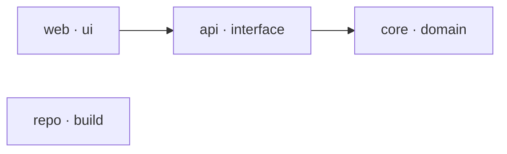

# Snag Desk: structure

<!-- Generated by blueprint.py render from .blueprint/blueprint.json. Do not edit. -->

A small snag tracker: a Rust engine records snags and an inbox web app lets a person review them.

**10 planned files, 1 patterns.** Status: ○ planned 2, ◔ claimed 1, ◑ on disk 3, ● built 1, ✔ verified 2, ▲ blocked 1. Last sync: 2026-11-05T21:04:59Z.

## Stack

| Part | Choice | Version | Docs | Checked |
|---|---|---|---|---|
| Engine language | Rust (Cargo workspace) | 1.91 | https://doc.rust-lang.org/cargo/reference/workspaces.html | 2026-11-05 |
| HTTP API | Axum | 0.8 | https://docs.rs/axum/latest/axum/ | 2026-11-05 |
| Web | React + TypeScript + Vite | React 19 | https://vite.dev/guide/ | 2026-11-05 |

## Build approach

- **layout:** Cargo workspace (crates/) plus apps/web; one shared API schema generated from Rust types
- **notes:** Phase 1 is a walking skeleton: one snag goes in through the API and shows in the inbox. Example only: files are placeholders and every verify command is a no-op, so all commands run anywhere.

## Tree

`★` shared contract · `○` planned · `◔` claimed · `◑` on disk · `●` built · `✔` verified · `▲` blocked

```text
.
├── apps/
│   └── web/  # Inbox where a person reviews snags [web]
│       ├── src/
│       │   ├── screens/
│       │   │   └── *Screen.tsx  ⟨pattern web-screen: One screen per inbox view; 1 on disk⟩ (frontend-engineer, P2)
│       │   ├── api.ts  ◔ Typed client for the snag endpoints (frontend-engineer, P1)
│       │   └── Inbox.tsx  ○ Inbox list of open snags (frontend-engineer, P1)
│       └── package.json  ▲ Web app manifest and scripts (frontend-engineer, P1)
├── crates/
│   ├── snag-api/  # HTTP API over the core [api]
│   │   ├── src/
│   │   │   └── main.rs  ● Axum server with POST /snags and GET /snags (backend-engineer, P1)
│   │   └── Cargo.toml  ◑ API crate manifest (backend-engineer, P1)
│   └── snag-core/  # Snag types and rules, no I/O [core]
│       ├── src/
│       │   ├── lib.rs ★  ✔ Snag, SnagId and SnagStatus types with validation (backend-lead, P1)
│       │   └── lifecycle.rs  ○ Allowed status transitions and their history records (backend-engineer, P2)
│       └── Cargo.toml  ◑ Core crate manifest (backend-engineer, P1)
├── Cargo.toml ★  ✔ Workspace manifest listing the crates (cto-architect, P1)
└── README.md [modify]  ◑ How to run the skeleton locally (cto-architect, P1)
```

## Modules



| Module | Path | Layer | Purpose | Depends on | Verify |
|---|---|---|---|---|---|
| core | `crates/snag-core` | domain | Snag types and rules, no I/O |  | `python -c "pass"` |
| api | `crates/snag-api` | interface | HTTP API over the core | core | `python -c "pass"` |
| web | `apps/web` | ui | Inbox where a person reviews snags | api | `python -c "pass"` |
| repo | `` | build | Workspace and CI configuration |  | `python -c "pass"` |

## Phases

| Phase | Name | Goal | Exit | Files | Verified |
|---|---|---|---|---|---|
| P1 | Walking skeleton | One snag created through the API appears in the inbox. | cargo test --workspace and pnpm --dir apps/web test pass | 9 | 2 |
| P2 | Snag lifecycle | Approve and close snags with history. | Lifecycle tests pass | 1 | 0 |

## Shared contracts

These files are depended on by several owners. Change them only through their owner.

| File | Owner | Produces | Purpose |
|---|---|---|---|
| `Cargo.toml` | cto-architect | workspace members | Workspace manifest listing the crates |
| `crates/snag-core/src/lib.rs` | backend-lead | type Snag, fn validate_snag | Snag, SnagId and SnagStatus types with validation |

## Repeated-file patterns

| Pattern | Glob | One instance contains | Owner | Phase | On disk |
|---|---|---|---|---|---|
| web-screen | `apps/web/src/screens/*Screen.tsx` | A React component that loads its data through api.ts and renders loading, empty and error states | frontend-engineer | P2 | 1 |

## Files

| File | Action | Module | Phase | Owner | Status | Purpose | Consumes | Produces | Verify |
|---|---|---|---|---|---|---|---|---|---|
| `Cargo.toml` | create | repo | P1 | cto-architect | ✔ verified | Workspace manifest listing the crates |  | workspace members | `python -c "pass"` |
| `crates/snag-core/Cargo.toml` | create | core | P1 | backend-engineer | ◑ on disk | Core crate manifest | workspace members |  | `python -c "pass"` |
| `crates/snag-core/src/lib.rs` | create | core | P1 | backend-lead | ✔ verified | Snag, SnagId and SnagStatus types with validation |  | type Snag, fn validate_snag | `python -c "pass"` |
| `crates/snag-api/Cargo.toml` | create | api | P1 | backend-engineer | ◑ on disk | API crate manifest | workspace members |  | `python -c "pass"` |
| `crates/snag-api/src/main.rs` | create | api | P1 | backend-engineer | ● built | Axum server with POST /snags and GET /snags | type Snag, fn validate_snag | POST /snags, GET /snags | `python -c "pass"` |
| `apps/web/package.json` | create | web | P1 | frontend-engineer | ▲ blocked | Web app manifest and scripts |  |  | `python -c "pass"` |
| `apps/web/src/api.ts` | create | web | P1 | frontend-engineer | ◔ claimed | Typed client for the snag endpoints | GET /snags | listSnags() | `python -c "pass"` |
| `apps/web/src/Inbox.tsx` | create | web | P1 | frontend-engineer | ○ planned | Inbox list of open snags | listSnags() |  | `python -c "pass"` |
| `crates/snag-core/src/lifecycle.rs` | create | core | P2 | backend-engineer | ○ planned | Allowed status transitions and their history records |  | fn transition | `python -c "pass"` |
| `README.md` | modify | repo | P1 | cto-architect | ◑ on disk | How to run the skeleton locally |  |  | `python -c "pass"` |

## Decisions

- **D1:** Generate the TypeScript client from the API schema instead of writing types twice. Why: The web app and API cannot drift apart. (example)

## Drift: 1 unplanned file(s)

On disk but not in the blueprint. Add each to the plan, cover it with a pattern, ignore it, or remove it.

- `notes/todo.txt`
